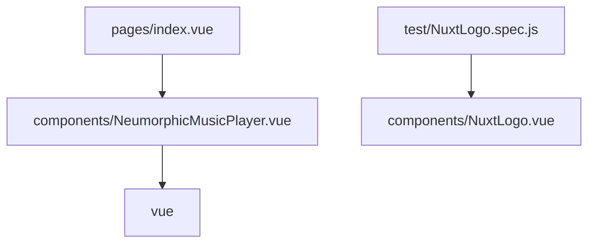

# Architecture

| Path | Role |
| --- | --- |
| `pages/index.vue` | Route `/`; imports [[NeumorphicMusicPlayer]] |
| `components/NeumorphicMusicPlayer.vue` | Player UI + playback state |
| `components/NuxtLogo.vue`, `Tutorial.vue` | Template leftovers |
| `store/` | Empty (README only) |
| `test/NuxtLogo.spec.js` | Jest spec |

> [!tip] Query the graph
> `graphify query "music player progress animation"`
> `graphify path "index.vue" "NeumorphicMusicPlayer.vue"`

Back to [[Project Overview]].
